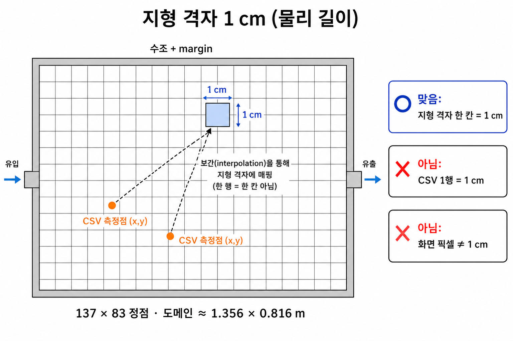

# 지형 격자 한 칸 = 1 cm (물리)

화면에 그리는 하상 격자는 화면 픽셀이 아니라 미터 단위 정규 격자입니다. CSV의 점들을 이 1 cm 격자로 보간해 면으로 표시합니다.

## 수치

| 항목 | 값 |
| --- | --- |
| 셀 한 변 | `0.01 m` (1 cm, `FLUME.terrainCellSize`) |
| 도메인 (X × Z) | 약 `1.356 × 0.816 m` (수조 + margin) |
| 정점 수 | `137 × 83` |

## 맞는 이해 / 흔한 오해

| 항목 | 판정 | 설명 |
| --- | --- | --- |
| 지형 격자 한 칸 | 맞음 | 1 cm (물리 길이) |
| 화면 픽셀 | 아님 | 카메라·창 크기에 따라 달라짐 |
| CSV 1행 | 아님 | `(x, y)` 간격·보간·중복 병합에 따라 영향 범위가 달라짐 |
| 바닥판 전체 크기 | 맞음 | CSV bbox가 아니라 수조 + margin 고정 도메인 |

같은 `(x, y)`에 `z`만 다른 행은 한 칸으로 합쳐집니다. CSV 발자국 밖은 변화 없음(`deltaElevations = 0`)입니다. 점 간격이 1 cm보다 촘촘하면 여러 행이 같은 칸에 들어가고, 성기면 보간으로 더 넓게 퍼집니다.

## 데이터 → 화면

1. CSV 행: `x, y, z, scrdif`
2. 하상 격자: CSV 고유 `x`/`y` 축에 `scrdif` 축약
3. `resampleBedToTerrain`: 이중선형 보간 → 1 cm 지형 격자
4. `TerrainGrid`: `deltaElevations` (137 × 83 정점)
5. 화면 메시: 지형 높이 변형

근거: `src/constants/experiment.ts`, `src/data/buildScrdifBedField.ts`
